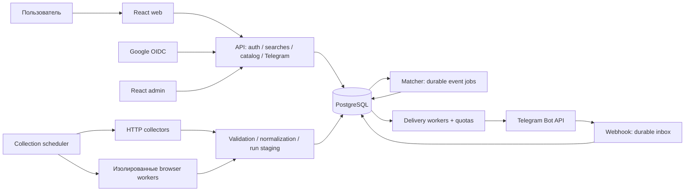

# Housing Monitor NL v2: общий каталог и персональные уведомления

Дата: 29 октября 2026. Обновлено: 31 октября 2026 — обязательный TypeScript и разработка в отдельной интеграционной ветке с изолированным staging. Статус: проект архитектуры и план реализации, не описание уже выпущенных возможностей.

## 1. Решения и границы

### Подтверждено пользователем

1. Собирать полный каталог объявлений подключённых сайтов; пользовательские фильтры применять на нашем сервере.
2. Сделать пользовательское веб-приложение с регистрацией и входом через Google.
3. Дать пользователю выбор источников, фильтров и подключение Telegram для персональных уведомлений.
4. Поддержать города по всем Нидерландам и дальнейшее добавление источников.
5. Первый продукт — **только аренда**, с **открытой бесплатной регистрацией**.
6. Существующие совпадения показывать в кабинете; в Telegram отправлять только последующие новые объявления, без рассылки старого каталога.
7. **Весь собственный код приложения и инструментов проекта перевести на TypeScript.** Удалить поддерживаемые исходники JavaScript (`.js`, `.jsx`, `.cjs`, `.mjs`), а не оставлять перенос в backlog. Это обязательная часть завершения апдейта, включая существующий код.
8. **Весь апдейт разрабатывать в отдельной долгоживущей интеграционной ветке, созданной от актуальной `main`.** Рабочие ветки создавать от неё; все промежуточные PR направлять в неё. Разработку, миграции и тестирование выполнять на отдельном staging-сервере, не затрагивая работающий production. В `main` апдейт попадает единым release PR только после полной приёмки.
9. Реализацию разбить на небольшие задачи, пригодные для отдельных субагентов. Этот документ не запускает реализацию или субагентов.

### Рекомендуемые решения, которые можно изменить до реализации

- Несколько сохранённых поисков на пользователя. Каждый поиск содержит источники, города, фильтры и переключатель уведомлений.
- Один личный Telegram-аккаунт на пользователя и один пользователь на Telegram-аккаунт. Группы и каналы остаются только в legacy-контуре до отдельной задачи.
- Первый интерфейс на английском; строки вынести в словарь для последующей локализации. Язык интерфейса и сообщений — отдельная пользовательская настройка в будущем.
- Стартовые конфигурируемые ограничения: 5 поисков на пользователя, 20 локаций и 50 элементов в выдаче на страницу. Это предложение для бесплатного запуска, не бизнес-требование.
- Под «полным каталогом» понимать доступные сервису объявления аренды жилья в фактической географии каждого источника: квартиры, дома, студии, комнаты; сохранять историю ранее увиденных объектов. Продажа, коммерческие помещения и гаражи не входят в жилой каталог. Неизвестный тип сохранять как unknown, а не отбрасывать.
- Не обещать сбор закрытых или технически недоступных объявлений. Для каждого источника явно описать границы доступа и доказательства полноты. Неполный сбор — состояние ошибки/ограничения, а не выполнение требования «всё».
- Основной релиз включает все текущие источники, прошедшие новую приёмку. Ограниченную бету можно открыть раньше с явно указанным меньшим набором; это не завершение миграции всех источников.
- Радиус, районы, карта, расширенные характеристики и межсайтовая группировка — последующие этапы, без задержки первой рабочей версии по городам.

### Не входит в этот апдейт

Оплаты, тарифы, заявки на жильё, бронирования, пользовательские аккаунты на сайтах-источниках, добавление произвольных URL пользователем, LLM в мониторинге, автоматический обход CAPTCHA/MFA, мобильные приложения. Администратор подключает новые адаптеры через код и проверку.

## 2. Основание плана и расхождения с v1

Профильные страницы Notion прочитаны при подготовке плана. Их содержимое датировано 23.10.2026; это требования, не сегодняшняя проверка production:

- [Архитектура и общие контракты](https://app.notion.com/p/402d10c6e6ab81f1a46cdcc948bb4faa).
- [Админка v1](https://app.notion.com/p/3fad10c6e6ab810f8b6ac405dee44aeb).
- [Backlog](https://app.notion.com/p/402d10c6e6ab815983ddf6700505fc7c).
- [Funda — текущие требования](https://app.notion.com/p/402d10c6e6ab8195868de764fcdce855).

Локально проверены `prisma/schema.prisma`, `src/listings/listings.service.ts`, `src/delivery/outbox.service.ts`, конфигурация Telegram, модуль приложения, реестр поисков, контракты Funda, документация админки/outbox и CI. Это адресный анализ архитектуры; аудит полноты каждого из 17 адаптеров ещё предстоит в задачах C.

| Сейчас, по коду и документации | Предлагаемое изменение |
|---|---|
| `SearchConfiguration` имеет PK `sourceId`, владельца `admin`; часть условий уходит в запрос источника | Отдельные `CollectionProfile` для технического сбора и `SavedSearch` для пользователя |
| Город, бюджет, радиус и свежесть могут ограничивать выдачу сайта | Общий арендный каталог без пользовательских ограничений; серверный поиск по сохранённым данным |
| `ListingsService` сохраняет объекты и сразу создаёт outbox одного назначения | Запись каталога и событий; отдельный matcher создаёт персональные уведомления |
| `HousingListing.city` — строка; часть характеристик упакована в `rawSourceRef` | Нормализованные локации и типизированные поля с явной неизвестностью |
| `TELEGRAM_CHAT_ID` обязателен; валидатор назначения допускает отрицательные ID групп | Мультипользовательские назначения, включая положительные ID личных чатов; legacy-группа отдельно |
| Outbox выбирает только один env-chat; глобальная пауза минимум 3,1 с | Планировщик доставки по чатам с общей квотой бота и справедливым распределением |
| `new:listingId:destination` — текущий ключ дедупликации | Устойчивая идентичность уведомления пользователя; несколько совпавших поисков не создают дубли |
| Pause источника останавливает проверки, оставляя созданный outbox | Пользовательская pause выключает его уведомления; глобальный сбор не меняется |
| Funda ограничена Groningen/радиусом/бюджетом/сегодня; есть небольшие лимиты обхода | Отдельная национальная стратегия обхода, контроль пагинации и честный статус покрытия |

Новые явные требования пользователя заменяют ограничения v1 на единственного владельца и фильтры в запросах источников. Это **запланированное изменение поведения**. Старые правила servicekosten, доступности, первичного baseline и неоднозначной доставки нельзя потерять при миграции. Перед изменением конкретного адаптера исполнитель читает его собственную профильную страницу Notion: правила одного сайта не переносятся на другой.

Notion при подготовке плана не изменялся. Перед реализацией согласованные изменения контрактов нужно отразить на профильных страницах; открытые предложения не превращать в утверждённые требования автоматически.

## 3. Продуктовая модель

### Разделение трёх независимых сущностей

**Источник** — сайт и техническое состояние его общего сборщика. Интервал, сессии, ограничения запросов и глобальное включение контролирует оператор.

**Сохранённый поиск** — персональный набор городов, источников и условий. Выбор сайта означает «показывать и присылать объявления этого сайта», а не «запускать отдельный парсер для меня». Изменение поиска не меняет задания сбора.

**Канал уведомлений** — подтверждённая связь пользователя с личным Telegram-чатом. Поиск может работать в кабинете без Telegram. Подключение канала не меняет фильтры.

Для N пользователей и S сайтов число сборов зависит от S и технического разбиения каталогов, а не от N×S. Даже если никто не выбрал сайт, его сбор следует операторской политике; автоматическое выключение по спросу не вводить скрытно.

### Первая версия пользовательского продукта

- Вход и создание аккаунта одним действием через Google; выход, управление сессиями и удаление аккаунта.
- Список сохранённых поисков: краткие условия, число текущих совпадений, статус уведомлений, состояние выбранных источников.
- Редактор поиска с серверной валидацией и предварительной выдачей без сохранения.
- Каталог совпадений с пагинацией, сортировкой по обнаружению/цене/площади и ссылкой на оригинал.
- Подключение, проверка и отключение Telegram; история уведомлений и понятные ошибки.
- Общая пауза уведомлений и пауза отдельного поиска.
- Админка для источников, покрытия, очередей, ошибок и безопасного повторного запуска операций.

Избранное, скрытые объявления, карта и платные функции не являются обязательными для первого релиза.

## 4. UX и пользовательские сценарии

### Информационная архитектура

| Экран | Главное действие | Обязательные состояния |
|---|---|---|
| Публичная страница | Войти через Google | Что делает сервис, какие сайты и география доступны, политика данных, отсутствие обещаний мгновенного обнаружения |
| Первый вход | Создать первый поиск | Восстановление шага после отмены Google/Telegram, возможность пропустить Telegram |
| Мои поиски | Открыть/создать/приостановить поиск | Пусто, загрузка, ошибка, частично устаревшие источники, лимит поисков |
| Поиск и результаты | Изменить фильтры и сохранить | Несохранённые изменения, preview, 0 результатов, конфликт 409, недоступный источник |
| Telegram | Подключить/отключить | Не подключён, ждёт Start, ждёт подтверждения в кабинете, подключён, заблокирован бот, истёкшая ссылка |
| Уведомления | Посмотреть результат доставки | В очереди, отправлено, отменено, ошибка, результат неизвестен |
| Настройки | Выйти/удалить аккаунт | Подтверждение удаления, повторная аутентификация для чувствительных действий |
| Админка | Восстановить источник/доставку | Роли, аудит действия, отличие неизвестного результата от подтверждённой ошибки |

### Первый вход и первый поиск

1. Пользователь нажимает «Continue with Google». Успешный callback создаёт/находит пользователя и серверную сессию, возвращает в onboarding.
2. Выбирает один или несколько городов из подсказок с названием провинции; либо явно «Все Нидерланды». Произвольная нераспознанная строка городом не становится.
3. Выбирает источники. Рядом — география и последний успешный сбор. Неподключённый источник нельзя включить; временно degraded можно оставить с предупреждением.
4. Задаёт бюджет, тип жилья, площадь и комнаты. Дополнительные условия раскрываются отдельно.
5. Видит существующие совпадения и предупреждения об отсутствующих полях. Preview не создаёт подписку или очередь Telegram.
6. Сохраняет поиск с именем. Сохранение и фиксация границы будущих событий атомарны.
7. Подключает Telegram сразу или позже. После подтверждения видит «Уведомления включены с …». Текущий каталог доступен в кабинете; массовой отправки нет.

### Редактирование и пауза

- Изменение формы не сохраняется автоматически. «Сохранить» создаёт новую revision; «Отмена» восстанавливает последнюю загруженную версию. Конфликт 409 предлагает обновить данные без молчаливой перезаписи.
- После сохранения выдача пересчитывается по текущему каталогу. Уже существующие объявления, впервые подошедшие новым условиям, не считаются новыми для Telegram.
- Смена источников/городов, возобновление поиска или повторное подключение Telegram устанавливает новую границу уведомлений. Пропущенное во время паузы не догоняем автоматически.
- Pending-задания старой версии поиска отменяются/переоцениваются по правилам раздела 8. Уже отправленное сообщение остаётся в истории.
- Общая pause влияет на уведомления всех поисков, а не на доступ к каталогу. UI отдельно показывает «поиск сохранён», «Telegram подключён» и «уведомления активны».

### Объявление и доверие к данным

Карточка показывает цену с её основанием, servicekosten отдельно, площадь, комнаты/спальни отдельно, город, тип, доступность, источник, время обнаружения и публикацию только если известна. Неизвестное поле — «не указано»; отсутствие даты не подменяется detectedAt. Цена «по запросу» не превращается в €0. Устаревшая информация помечается по состоянию источника.

Telegram-сообщение: краткие факты, источник, совпавшие поиски, ссылка на оригинал и кабинет. В кабинете видна история независимо от доставки. Фото — необязательное улучшение после проверки допустимости использования и безопасности загрузки; текстовая доставка обязательна.

### Качество интерфейса

Mobile-first, клавиатурная навигация, доступные labels/focus, контраст, видимые ошибки полей, корректные loading/empty/error состояния. Сохранение блокирует двойной submit. Ошибка сети сохраняет введённую форму. Состояние привязки можно обновлять коротким polling только пока открыт экран; WebSocket для первого релиза не нужен. Даты храним в UTC, показываем в выбранной зоне с default Europe/Amsterdam.

## 5. Фильтры и география

### Что берём из Funda

Funda описывает сочетание нескольких локаций и групп фильтров по характеристикам жилья; отдельные арендные фильтры включают тип договора, меблировку и включение servicekosten. Это ориентир для структуры UX, не контракт наших данных и не требование копировать весь интерфейс. См. [поиск и локации Funda](https://www.funda.nl/meer-weten/producten-en-diensten/zoeken-op-funda/) и [арендные условия Funda](https://www.funda.nl/meer-weten/producten-en-diensten/nieuw/huurder-kan-nu-ook-filteren-op-type-overeenkomst-en-huurcondities/).

### Контракт первой версии

| Группа | Поля | Точное правило |
|---|---|---|
| Источники | `sourceIds[]` | Непустой список доступных источников; OR внутри списка |
| География | `locationIds[]` либо `allNetherlands=true` | OR между городами; город — нормализованная woonplaats, не муниципалитет и не подстрока адреса |
| Цена | `rentMin`, `rentMax`, `priceBasis=advertised_monthly` | EUR/месяц, включительные границы; только сравнимые цены; servicekosten не прибавлять |
| Тип жилья | `propertyTypes[]` | apartment, house, studio, room, other_residential; пустой список = любой жилой тип |
| Площадь | `areaMin`, `areaMax` | м², включительные границы, min ≤ max |
| Комнаты | `roomsMin` | Общее число комнат; не равно числу спален |
| Спальни | `bedroomsMin` | Отдельное поле, показывать доступность данных |
| Доступность | По умолчанию явно доступное жильё | `available`, `unavailable`, `unknown`, `applications_closed` различаются; адаптер сохраняет основание статуса |
| Неизвестные поля | `unknownPolicy=exclude` по умолчанию | Активное условие по неизвестному полю не проходит; неактивное условие неизвестность не исключает |

Между группами — AND. Внутри multi-select — OR. Пустой фильтр означает отсутствие ограничения, а не нулевое значение. Сервер возвращает объяснение несовпадения по кодам (`PRICE_UNKNOWN`, `CITY_UNRESOLVED`, `AREA_TOO_SMALL`), пригодным для UI и тестов.

Для каталога можно отдельно включить неизвестную доступность и явно неизвестные значения; для уведомлений в первом релизе неизвестная доступность не проходит. Настройку включения неизвестных характеристик добавлять только с единым контрактом preview/matcher и явным предупреждением. Нельзя обещать фильтрацию по данным, которые сайт не предоставляет: API capabilities показывает поддержку/полноту полей, UI предупреждает о снижении охвата.

### Следующий этап фильтров

Меблировка (`kaal`, `gestoffeerd`, `gemeubileerd`, unknown), срок/тип договора, дата заселения, энергетический класс как enum с порядком, балкон/сад/лифт/парковка, животные (yes/no/negotiable/unknown), доступность для регистрации, ключевые слова. Включать по одному полю после нормализации и проверки качества источников. «Не указано» не равно «нет». Не выводить пригодность для huurtoeslag или размер обязательного дохода из догадок.

Режим полного месячного бюджета возможен позже: отдельная метрика с явным составом платежей и unknown при неполной сумме. Нельзя складывать servicekosten повторно, если они уже входят в объявленную цену.

Фильтр «опубликовано за N дней» — будущая опция с отдельной политикой для неизвестного publishedAt; он не должен ограничивать сбор каталога.

### География по этапам

1. **Релиз v2:** справочник городов NL со стабильными внутренними ID, внешними ссылками на геоданные, провинцией, aliases и историей переназваний. Нормализация написаний (`Den Haag`/`'s-Gravenhage`) с ручной очередью неоднозначностей. Исходное название сохраняется. Геокодер асинхронный, с кешем; его отказ не останавливает сохранение объектов.
2. **v2.1:** муниципалитеты, районы, postcode и радиус. Для радиуса нужны координаты и их точность; центр города нельзя выдавать за точную координату дома. Выбор города без радиуса означает принадлежность woonplaats, а с радиусом — отдельную геометрическую операцию вокруг обозначенного центра.
3. **Позже:** карта и полигоны пользователя. PostGIS вводить перед пространственными запросами после проверки поддержки в используемой БД; для равенства cityId он не обязателен.

Кандидат на внешний справочник/геокодер — PDOK. До интеграции проверить подходящие коллекции, актуальный API, лицензию, attribution, квоты и возможность локального импорта. Официальная [спецификация PDOK Location API](https://api.pdok.nl/kadaster/location-api/v1/api?f=html) содержит коллекции woonplaats и административных территорий; выбор между Location API и Locatieserver вынесен в задачу G01. Постоянный внутренний ID не должен зависеть от стабильности ID поискового ответа внешнего сервиса.

## 6. Целевая архитектура

### Подход

Сохранить NestJS/TypeScript, PostgreSQL/Prisma, React и существующие HTTP/browser adapters. Организовать модульный backend с независимо запускаемыми ролями. Для первого релиза использовать PostgreSQL jobs/leases/outbox; Redis/BullMQ не являются обязательным условием апдейта. Решение о замене очереди принимается по измеренной задержке/конкуренции, не по числу пользователей само по себе.

### Обязательный стандарт языка: только TypeScript

- Backend, frontend (`.tsx` для React), адаптеры, browser workers, scheduler, matching, Telegram, CLI, административные утилиты, smoke/диагностические скрипты, тесты и программные конфиги — собственные исходники `.ts`/`.tsx`. Новую исполняемую логику не писать на JS/CJS/MJS или другом скриптовом языке.
- Перенести **существующий**, а не только новый код: общие `scripts/*.cjs`, поисковые модули, browser lifecycle/session helpers, telemetry, CLI и `test/*.mjs`, а также оставшийся код в других каталогах. Удалить старые исходники и обновить все импорты, package scripts, Docker entrypoints, Compose/Railway start commands, CI и runbooks. Архивный исполняемый код тоже переносится либо удаляется как неиспользуемый, а не прячется от проверки расширений.
- Один согласованный способ разрешения модулей и запуска TS для всех компонентов. В production сервер/worker запускает собранный артефакт; dev, CLI и тесты используют согласованный TS runner или предварительную сборку. Перенос не сводится к смене расширения: включить `strict`, `allowJs: false`, проверять все собственные TS-проекты и не обходить типизацию через `@ts-nocheck`, массовый `any` или отключение проверок.
- Сохранить runtime-валидацию внешних данных: статическая типизация не заменяет проверку HTTP/browser/Telegram payload. Не менять фильтры, дедупликацию, session handling или доставку под видом языкового переноса; отдельно проверить паритет поведения.
- JavaScript, который **генерируют** TypeScript/Vite и зависимости, допустим в `dist`, frontend bundles и `node_modules`: это результат сборки или сторонний код, а не поддерживаемые исходники проекта. SQL-миграции, Prisma schema, HTML/CSS, JSON/YAML, Dockerfile, Markdown и сырые тестовые данные остаются в своих штатных форматах. Исполняемые JS-вставки в Docker/CI не маскировать под конфигурацию: вынести их в типизированные TS-утилиты.
- CI проверяет отсутствие собственных `.js`/`.jsx`/`.cjs`/`.mjs` исходников, inline JS-скриптов, старых путей запуска и `allowJs`. На время поэтапной миграции допускается только зафиксированный убывающий список старых файлов; новые исключения запрещены. До публичного релиза список должен быть пустым. Собранные артефакты и сторонние зависимости исключаются из этой проверки явно.

### Основные HTTP-контракты

Все пользовательские endpoints требуют сессии; исключения — начало/callback Google и Telegram webhook с собственной проверкой. Префикс `/api/v1` опущен в таблице. Mutations защищены CSRF/Origin; webhook имеет отдельную аутентификацию.

| Метод и маршрут | Контракт |
|---|---|
| `GET /auth/google/start`, `GET /auth/google/callback` | Одноразовый auth transaction и безопасный возврат |
| `GET /me`, `POST /auth/logout`, `POST /me/sessions/revoke` | Текущий пользователь и управление сессиями |
| `GET /sources`, `GET /locations?q=…` | Только безопасные capabilities/coverage и ограниченные подсказки |
| `GET/POST /searches`, `GET/PATCH/DELETE /searches/:id` | Только owner; PATCH с expected revision, иначе 409 |
| `POST /searches/preview` | Валидированный несохранённый фильтр; без notifications и побочных эффектов |
| `GET /searches/:id/listings?cursor=…` | Owner search + типизированный порядок и opaque cursor |
| `POST /searches/:id/pause`, `POST /searches/:id/resume` | Новая revision и cancellation/activation semantics |
| `POST /me/notifications/pause`, `POST /me/notifications/resume` | Общая pause/новая граница канала |
| `GET /telegram/connection`, `POST /telegram/link-tokens` | Свой статус и короткоживущий deep link |
| `POST /telegram/confirm`, `DELETE /telegram/connection` | Подтверждение исходной сессией либо отзыв связи |
| `POST /telegram/test`, `GET /notifications` | Идемпотентный тест и owner-scoped история |
| `POST /telegram/webhook` | Secret header + durable unique updateId; пользовательская cookie не нужна |
| `DELETE /me` | Отзыв доступа/доставки немедленно, удаление асинхронно |

Errors: стабильный code, безопасное message, field errors, requestId; 401/403/404/409/422/429 различаются. Недоступный чужой ресурс обычно возвращает 404 без раскрытия существования. Cursor не позволяет менять владельца или обходить фильтры; смена фильтра/сортировки сбрасывает пагинацию.

### Модули и ответственность

| Модуль | Ответственность | Не должен делать |
|---|---|---|
| Identity | Google identity, server sessions, roles, account lifecycle | Управлять сессиями сайтов-источников |
| Collection | Профили обхода, технические partitions, scheduler/lease, browser protocol | Читать пользовательские бюджеты или chat IDs |
| Catalog | Валидация, нормализация, история и публикация listing events | Вызывать Telegram внутри записи каталога |
| Geography | Справочник, aliases, координаты, разрешение неоднозначностей | Угадывать город молча |
| Searches | Owner-scoped CRUD, revisions, лимиты, границы событий | Менять расписание источника |
| Matching | Единая семантика фильтров, fanout и прогресс обработки | Держать транзакцию на всех подписчиков |
| Notifications | Delivery intents, дедупликация, история, отмена | Решать полноту внешнего обхода |
| Telegram | Связь аккаунта, inbox, транспорт и квоты | Принимать chatId из пользовательского JSON как доказательство владения |
| Operations | Health, coverage, audit, DLQ/UNCERTAIN, feature flags | Давать обычному пользователю глобальный /check |

Предлагаемые новые пути: `web/`, `src/auth/`, `src/users/`, `src/searches/`, `src/catalog/`, `src/geography/`, `src/matching/`, `src/notifications/`, `src/telegram/`, `src/contracts/`. Существующие `admin/`, `src/sources/`, `scripts/` сохранять до поэтапного перевода. Полный переход собственного кода на TypeScript обязателен в рамках этого апдейта: выполнять его небольшими проверяемыми переносами, а адаптеры мигрировать по одному. До завершения перехода публичный релиз v2 не считается готовым.

### Runtime и инфраструктура

- API отдаёт web по `/app/`, admin по `/admin/`, публичные версии API по `/api/v1/`; единый origin снижает сложность cookie/CORS. Landing можно отдавать статически тем же сервисом.
- Роли процессов: `api`, `collector`, `matcher`, `delivery`, `maintenance`. Сначала несколько ролей могут жить в одном процессе, но включаются явно; API-реплика не должна случайно включать scheduler или polling.
- Тяжёлые browser workers остаются изолированными по источнику/профилю. Lease включает fencing token, heartbeat, deadline и защиту от позднего результата старого worker.
- В PostgreSQL — durable jobs с `FOR UPDATE SKIP LOCKED`, lease/retry/backoff, ограниченными batch и DLQ. Никаких сетевых вызовов внутри долгой транзакции.
- Индексы под source/city/status/price/area и keyset pagination; выбор индексов подтвердить EXPLAIN на репрезентативных данных. Не выполнять полный fanout или точный count всего каталога на каждом нажатии клавиши.
- Сборка frontend отдельно проверяется CI; релизный образ API содержит оба UI. Секреты остаются в серверном окружении Railway. Staging имеет отдельные БД, OAuth callback и бота.

## 7. Данные и контракты

Названия таблиц — проектные; итоговые миграции должны сохранять существующие ID и историю.

| Сущность | Ключевые поля и ограничения |
|---|---|
| `User` | id, status, displayName, locale/timezone, createdAt, deletedAt; роль выдаётся сервером |
| `AuthIdentity` | userId, issuer, subject, email, emailVerified; unique(issuer, subject), email не первичный идентификатор |
| `UserSession` | hash случайного token, userId, expiresAt, lastSeenAt; CSRF; индекс expiry |
| `CollectionProfile` | sourceId, contractVersion, technical scope/partitions, configRevision; без персональных фильтров |
| `CollectionRun` / расширенный `MonitoringRun` | scopeVersion, partition, cursor, completeness, counts, error, lastSuccessfulCheckpoint; attempt отдельно от success |
| `ListingPublishedVersion` / projection | listingId, runId, immutable normalized snapshot; API читает только опубликованные версии, незавершённый run не перезаписывает прежнюю видимую версию |
| `CollectionStaging` / manifest | данные страниц и batch, runId, checksum, состояние валидации и публикации; TTL незавершённых run |
| `Location` / `LocationAlias` | внутренний ID, тип, провинция/родитель, external references, aliases, version; неоднозначность не разрешать одним lowercase |
| `HousingListing` | старый id/sourceId/externalId/URL, cityRaw + locationId, typed price basis/period, area, rooms/bedrooms, propertyType, availability, field provenance, timestamps |
| `ListingObservation` | runId, listingId, observedAt, изменившиеся поля/хеш; ограниченная retention |
| `ListingEvent` | sourceId, sourceSequence, listingId, type, runId, occurredAt, backfill flag; unique(sourceId, sourceSequence) |
| `SourceEventCursor` | последний опубликованный sequence, короткая блокировка на финальной публикации; sequence соответствует порядку публикации |
| `SavedSearch` | userId, name, revision, status, filtersVersion, canonical filter payload, notificationEnabled; все запросы с owner |
| `SavedSearchSource` / `SavedSearchLocation` | sourceId/locationId и связь с search; нужны индексы для shortlist matcher |
| `SearchRevision` / `SearchActivation` | immutable snapshot, actor, per-source event watermarks, activation reason и время |
| `TelegramLinkToken` | hash token, userId/session, expiresAt, consumedAt, candidateTelegramId; короткая жизнь, одно использование |
| `TelegramConnection` | userId unique, telegramUserId unique, chatId как строка/BigInt, status, generation, verifiedAt; связь только через приватный chat |
| `TelegramInbox` | botId, updateId unique, минимальный payload, status/attempts; доставка update идемпотентна |
| `MatchJob` / `MatchReceipt` | eventId, batch cursor, status, attempts; unique(eventId, searchId, revision) для результатов |
| `NotificationIntent` | userId, listingId, eventKind, matched search references, status; unique(userId, listingId, eventKind) для первого NEW |
| `NotificationOutbox` | intentId, connectionId + generation, immutable destination snapshot, payloadVersion, lease, result; legacy-поля сохраняются при переходе |
| `NotificationSearchMatch` | intentId, searchId/revision; several searches → one intent; удаление поиска не уничтожает sent history |
| `DeliveryQuota` | bot-wide и per-chat ограничения/nextAttemptAt; атомарные reservations |
| `AuditEvent` | actor, action, target, timestamp, безопасные изменения; без токенов/cookies и полного Telegram payload |

`rawSourceRef` сейчас используется и для JSON дополнительных характеристик. Миграция переносит распознанные поля в типизированные колонки/версионированные attributes; непонятные значения сохраняет без потери исходника. Raw-данные и cookies не выдаются пользовательскому API.

Контракты: `NormalizedListingV2`, `CollectionScopeV2`, `SavedSearchFilterV1`, `ListingEventV1`, `NotificationPayloadV1`, OpenAPI DTO и коды ошибок. Runtime-валидация на границе API и worker, версия схемы и совместимости, тестовые fixtures. Frontend получает типы/справочники через общий контракт, а не через импорт внутренних CJS модулей.

## 8. Сбор, matching и доставка: обязательная семантика

### 8.1 Полный сбор и восстановление

1. Для каждого сайта исследовать национальный список, пагинацию, лимиты результата и детализацию. Где невозможно получить всё одним запросом, разбивать технически по городам/регионам/диапазонам с доказуемым покрытием и дедупликацией пересечений. Эти partitions не зависят от пользовательского поиска.
2. Первоначальный полный обход создаёт inventory baseline без NEW-рассылки. Расширение scope, добавление источника и импорт истории тоже помечаются backfill. Старый `Source.baselineAt` недостаточен для нового национального scope.
3. Внутри большого run использовать bounded batch и staging, а не одну транзакцию на весь национальный каталог. Проверять страницы, повторяющиеся ID/курсоры, заявленное число результатов и закрытие всех partitions.
4. После валидации публиковать batch идемпотентно; matcher читает события только run со статусом `PUBLISHED`. Финальный статус выставляется после всех batch. До этого они не видны в пользовательском каталоге как новый подтверждённый снимок и не создают доставку. Реализация должна хранить подтверждённую версию отдельно от незавершённых обновлений.
5. После сбоя публикация продолжается по manifest без потери данных и дублей. Пагинация до hard limit — `PARTIAL`, не success. Неполный run не продвигает coverage baseline/lastSuccess и не закрывает отсутствующие объекты.
6. После bootstrap — incremental обход новых/изменённых карточек плюс периодическая полная сверка. Для источников без надёжного incremental контракта остаётся полный обход; интервал определяется реальной стоимостью и квотами.
7. Исчезновение из списка не означает сдачу. Помечать stale отдельно; unavailable — только по подтверждённому сигналу/согласованному правилу источника. Сбой геокодера или неизвестная площадь не исключает объект из хранилища.
8. Сохранять прежние source/listing IDs, URL identity и специальные правила stableExternalId. Национальный scope получает новую версию профиля, не новые дублирующие сайты.

### 8.2 Граница «только новые»

Основная единица первого релиза — `NEW`: впервые обнаруженный объект после завершения baseline этого scope. Изменение цены, появление недостающих полей и повторная доступность — отдельные события, сохраняемые для будущего; уведомления по ним по умолчанию выключены. Существующие особые правила legacy-получателя до миграции сохраняются отдельно.

При активации/редактировании поиска фиксируется per-source watermark опубликованных listing events. Только NEW с sequence выше watermark может создать уведомление этой revision. При подключении Telegram и снятии общей pause устанавливается дополнительная граница канала для всех доступных источников; у добавленного позже источника действует его собственный тихий baseline и последующая граница активации поиска; итоговая граница — максимум соответствующих watermarks. Уже стоящие в очереди старые события не обходят это правило.

**Гонка commit — часть контракта:** обычный `MAX(id)`/timestamp/DB sequence не гарантирует порядок commit. Публикация событий и фиксация watermarks используют одни и те же короткие блокировки `SourceEventCursor`; при нескольких источниках — стабильный порядок sourceId. Публиковать события только после подтверждения run, под выделенным source sequence. Сохранение поиска не держит блокировки во время сетевого сбора или обработки каталога. Тестировать обе очередности commit и позднее завершение run.

Граница означает время подтверждённого обнаружения нашим сервисом. Она не гарантирует точную дату появления на внешнем сайте. Первое обнаружение после простоя может относиться к более старой публикации; это следует показать в UX, а не скрывать фильтром «сегодня».

### 8.3 Matching без N×M полного перебора

- Запись каталога и durable событие связаны транзакционно/через publication manifest. Matcher независимо берёт committed события; рестарт не теряет работу.
- Shortlist по source, location и состоянию поиска, затем общий типизированный predicate. Preview и matcher используют один контракт семантики; при SQL-оптимизации — обязательные parity fixtures.
- Событие обрабатывается частями с durable cursor. Для повторов есть match receipts и уникальные ограничения; никакой транзакции на всех пользователей.
- Аккаунты deleted/suspended, неактивные поиски, неподтверждённые Telegram и события до watermarks исключаются до outbox.
- Несколько совпавших поисков одного пользователя объединяются в один `NotificationIntent` для listing NEW. Повторная обработка не создаёт нового сообщения. Быстрый sender может успеть отправить до обработки второго поиска: отсутствие второго названия в тексте допустимо, второе сообщение — нет.
- Cross-source объявления пока остаются разными listing: одинаковый адрес без номера квартиры не основание слияния. В v2.1 возможна отдельная confidence-based группировка; её нельзя включать без тестов на разные квартиры в одном доме.

### 8.4 Изменение поиска и cancellation

В одной транзакции с revision/pause/delete отметить связанные pending matches недействительными. Перед отправкой повторно проверить: жив ли пользователь, активен ли хотя бы один связанный поиск в текущей revision, подходит ли актуальный объект, не отменён ли intent, совпадает ли generation Telegram. Если все причины доставки исчезли — `CANCELLED`, без увеличения сетевых попыток.

При смене revision не догонять старый каталог. Поиск в кабинете пересчитывается сразу. Pending intent, который поддерживается другим неизменившимся активным поиском, может сохраниться.

Отправка использует короткую атомарную reservation и затем сеть вне транзакции. После того как сетевой запрос уже начался, pause/unlink не могут отозвать его. UI и документация честно описывают максимум одного уже отправляемого сообщения; новые запросы после отключения запрещены.

### 8.5 Telegram и гарантии

- Отдельный бот/контур для staging; для пользователей рекомендуется отдельный от legacy/admin-alert бота, чтобы не смешивать команды и групповые квоты.
- Outbox выбирает подтверждённые активные connection, не env `TELEGRAM_CHAT_ID`. Chat ID не ограничивается отрицательными числами и не приводится к потенциально неточному JS number.
- Сохраняются SENT, DEAD_LETTER, UNCERTAIN; добавляется CANCELLED. Неоднозначный timeout/сбой после HTTP send → UNCERTAIN без слепого автоматического повтора. Exactly-once у внешнего Bot API не обещается; application deduplication обязательна.
- Уникальность NEW намерения не зависит от connection generation: переподключение не пересылает прежние объявления. Generation защищает маршрутизацию, а destination snapshot не позволяет отправить старый payload новому аккаунту.
- Общая квота бота и отдельные квоты чатов, fairness между пользователями, обработка `retry_after`. Ошибка одного private chat не блокирует всех; 401 бота — глобальная остановка и операторский alert.
- 403 «bot blocked» отключает конкретную connection, отменяет pending сообщения и показывает действие в UI. После повторного подключения — новая граница без backlog.
- Квоты конфигурируемые и консервативные; перед выпуском сверить [официальный FAQ Telegram по ограничениям](https://core.telegram.org/bots/faq#my-bot-is-hitting-limits-how-do-i-avoid-this). Текущая глобальная задержка 3,1 с не подходит как конечная модель многопользовательской доставки.
- Стартуем с индивидуальных сообщений. Дайджесты/quiet hours добавить отдельно с явной семантикой и проверкой устаревания, не скрывать перегрузку необозначенным отбрасыванием.

## 9. Авторизация, привязка Telegram и безопасность

### Google и серверные сессии

Рекомендуется server-side OpenID Connect Authorization Code flow с проверенной библиотекой, без самостоятельной криптографии. Проверить возможности выбранной библиотеки и runtime перед фиксацией зависимости. `state`, `nonce`, точный redirect URI, проверка подписи/issuer/audience/expiry; PKCE, где поддерживает выбранная интеграция. Identity — `(issuer, sub)`, а не email. Только необходимые scopes `openid email profile`; доступ к Gmail/Drive не нужен. Основание: [официальный OIDC Google](https://developers.google.com/identity/openid-connect/openid-connect).

В браузере — opaque session cookie Secure/HttpOnly/SameSite, token hash в БД, rotation при входе, TTL и отзыв всех сессий. CSRF и Origin checks на мутациях, CORS allowlist, защита returnTo от open redirect. Токены Google и session не помещать в localStorage. Google access/refresh tokens не хранить, если они больше не нужны после входа. Email не связывает аккаунты автоматически.

Обычный пользователь не видит admin endpoints, задания источников, чужие search/notification/connection IDs. Все owner-scoped операции проверяют владельца на сервере, включая вложенные сущности. Админская роль выдаётся явно; совпадение email или первый зарегистрированный пользователь не дают права администратора. Для общего rate limit нескольких реплик нужен общий storage.

### Привязка Telegram без ручного chatId

1. Авторизованный пользователь запрашивает одноразовый link token. В БД хранится hash, срок жизни, user/session; токен не содержит userId/email.
2. Кабинет открывает deep link `https://t.me/<bot>?start=<opaque-token>` и показывает QR для другого устройства. Токен соответствует ограничениям [Telegram deep linking](https://core.telegram.org/bots/features#deep-linking).
3. Пользователь нажимает Start. Бот получает update только из private chat, проверяет токен и фиксирует кандидата (Telegram user/chat), **ещё не включая доставку**.
4. Кабинет показывает кандидата; пользователь подтверждает связь в исходной авторизованной сессии. Это защищает от случайной пересылки deep link другому человеку. Токен поглощается атомарно; повтор, просрочка и чужая активная связь дают безопасную ошибку.
5. Уникальные ограничения закрепляют один Telegram за одним User. Для смены сначала отключить старую связь с подтверждением; автоматического захвата чужой связи нет.
6. Создаётся connection generation и watermark активации. Тестовое сообщение отправляется по явной кнопке и проходит тот же outbox/квоты; повтор кнопки ограничен idempotency/rate limit.

В production рекомендуется webhook с проверкой secret header и body limit; update сначала durable сохраняется с unique updateId, затем обрабатывается. Поля Telegram не являются HTML для интерфейса. На одном боте webhook и long polling не работают одновременно; переключение выполнять отдельной release-задачей. См. [Bot API setWebhook](https://core.telegram.org/bots/api#setwebhook).

Команды пользователя `/status`, `/pause`, `/resume` работают только с его связью. `/check` и глобальный `/list` v1 не переносить в public bot: нельзя разрешать запуск общих browser workers каждому зарегистрированному пользователю.

### Эксплуатационная безопасность и данные

- Общие лимиты регистрации, поиска/preview, создания поисков, выдачи link tokens и тестовых сообщений. Ограничения на пользователя/IP с доверенной конфигурацией proxy; публичная регистрация не должна умножать нагрузку на сайты.
- XSS-защита: текст источников рендерить как текст, URLs проверять. Медиа/редиректы — allowlist, SSRF-защита, timeout/size limits. Произвольные URL пользователю не принимать.
- Удаление аккаунта сначала прекращает доставку и отзывает сессии/связь, затем удаляет персональные данные и поиски; очищает payloads из очереди/истории согласно принятой retention. Общий каталог жилья остаётся.
- Предложение retention для технического проектирования: link tokens 10 минут, inbox payload 7 дней, уведомления/аудит 90 дней, raw snapshots 30 дней. Значения и необходимость хранения утвердить перед выпуском; документация должна описывать backup expiry и срок фактического удаления. Это не юридическое заключение.
- Минимизация email/Telegram ID, отсутствие PII в Sentry/logs/metrics labels, секреты в защищённом окружении, backups с проверяемым restore. Страница privacy/data use и контакт для удаления — обязательная часть публичного запуска.

## 10. Наблюдаемость, ёмкость и критерии качества

Предлагаемые цели подлежат подтверждению нагрузочными проверками; это не обещание пользователям до измерений:

| Область | Цель / сигнал |
|---|---|
| API | p95 чтения <500 мс, preview <1 с на согласованной нагрузке; внешние OAuth/Telegram запросы отдельно |
| Новое событие → matching | p95 <30 с после публикации run; измерять старейшее необработанное событие |
| Match → доставка | p95 <60 с при нормальной квоте; 429/UNCERTAIN отдельно от healthy latency |
| Обнаружение | latency внешней публикации только если publishedAt достоверен; иначе измерять возраст последнего успешного сбора/coverage |
| Сбор | полное покрытие baseline и периодических сверок; интервал 15 минут — стартовая настройка, национальный обход требует отдельной оценки |
| Корректность | 0 утечек между пользователями; 0 повторных confirmed NEW intent на пользователя/listing; отсутствие рассылки baseline |
| Восстановление | предложение RPO ≤24 ч и RTO ≤4 ч; проверить поддержку/стоимость backup и провести restore drill |

Предварительный профиль нагрузки: 1 000 активных пользователей, до 5 поисков на каждого, 100 000 текущих объектов, burst 1 000 NEW events. Это тестовый сценарий для проектирования, не прогноз объёма NL. До публичного запуска измерить реальные объёмы по сайтам и стоимость полного обхода; при несоответствии пересчитать профиль и бюджет Railway.

Доставку рассчитывать отдельно: 1 000 событий × среднее число получателей даёт размер fanout; деление на фактически разрешённую скорость бота определяет минимальное время очереди. Если цель <60 с физически невыполнима, ограничить beta capacity/ввести явно согласованный режим дайджеста и пересмотреть обещания, а не скрывать задержку.

Метрики: source attempt/success/coverage age, pages/objects/detail calls, unknown-field rate, city resolution rate, event lag, match fanout/lag, outbox age/status, per-chat failures, DB locks/connections, browser RAM, API latency, registration abuse. Correlation IDs: run/event/job/intent, без email/chat ID в метках. Alerts — оператору, не всем пользователям; public UI показывает безопасный статус и время последнего успеха.

## 11. Миграция и выпуск без массовой рассылки

### Ветки, PR и отдельный сервер — обязательный workflow

Предлагаемое имя интеграционной ветки — `codex/platform-v2`; точное имя фиксируется в B01 до старта. Это одна общая ветка всего апдейта, аналог `development`/`update`, а не рабочая ветка одной задачи. Ниже имя используется как конкретный пример. Создание веток, PR и серверов — будущие задачи реализации, этот документ их не выполняет.

1. В начале реализации получить актуальную `origin/main`, зафиксировать исходный commit SHA и создать от него интеграционную ветку. Не включать случайные локальные изменения; требуемые подготовительные документы перенести отдельным проверяемым коммитом/PR.
2. Каждую ветку задачи (`codex/<task-id>-<slug>`) создавать от актуальной интеграционной ветки. Перед стартом зависимой задачи её prerequisites должны быть уже merged в эту ветку. Каждый субагент получает точные integration base/ref, target branch и изолированный checkout.
3. Все PR отдельных задач, исправлений, миграций, TypeScript-переноса и тестов имеют **base = интеграционная ветка**. В `main` промежуточные PR апдейта не открывать и изменения напрямую не коммитить. Даже готовая отдельная часть остаётся в интеграционном контуре до общего выпуска.
4. Для интеграционной ветки настроить CI на PR и push, обязательные проверки и review. Проверять merge-result относительно неё; PR guard отвергает ошибочную base `main` у задач апдейта. Исключение — единственный итоговый release PR. Интеграционную ветку не force-push/rebase после начала совместной работы.
5. Из интеграционной ветки разворачивать **отдельный staging-сервер/изолированное Railway environment** со своим URL, API, workers, БД, volumes, browser profiles, секретами, OAuth callback и Telegram-ботом. Не переиспользовать production DB, очередь, cookies/profiles, webhook или deployment target. Staging не имеет credentials/сетевого доступа на запись в production. Конфигурацию окружений проверять fail-closed до миграции и запуска sender.
6. В production сохраняются `main`, текущие сервисы, данные, расписание и доставка. Все expand migrations, backfill, shadow collection/matching, beta и rehearsal до release выполняются **только в staging**. Для проверки миграции можно использовать отдельно подготовленную обезличенную копию данных без рабочих токенов и Telegram destinations. Дополнительный сбор внешних сайтов имеет отдельные лимиты, чтобы тестирование не мешало штатному мониторингу.
7. Production hotfix, если он потребуется независимо от апдейта, идёт своим обычным процессом через `main`; затем изменения `main` явно вливаются в интеграционную ветку. Перед выпуском обязательно синхронизировать её с актуальной `main`, разрешить конфликты и повторить затронутую приёмку. Обратный перенос незавершённого v2 в `main` запрещён.
8. На финальном integration commit зафиксировать release candidate SHA, результаты CI/E2E/load/restore/migration/rollback и staging deployment. Если меняется commit, подтвердить актуальность проверок заново: нельзя выпускать непроверенную комбинацию после разрешения конфликтов.
9. После полной готовности открыть один release PR **интеграционная ветка → `main`** с итоговым diff, отчётом приёмки, планом миграции/cutover и rollback. Merge в `main` выполняется после финального ревью и решения о выпуске. Этот PR не заменяет проверки уже интегрированного приложения.
10. Только после merge выпускать v2 в production по проверенному runbook. Настроить release gate так, чтобы auto-deploy/pre-deploy не запустили миграции или обновление production раньше согласованного окна. Проверить итоговый main commit/build; предпочтительно продвигать проверенный неизменяемый артефакт, а не собирать неподтверждённую версию.

Логическая цепочка: `main → integration → task branches → PR в integration → staging и полная приёмка → release PR в main → production rollout`. Выбор ветки сам по себе не обеспечивает изоляцию: отдельные данные, секреты, workers и deployment rules обязательны.

### Этапы миграции и выпуска

Этапы 1–8 выполняются в интеграционной ветке и staging. Production-изменения начинаются только после этапа 9; подготовка расширяющей схемы не является исключением.

1. **Контракты:** зафиксировать ADR, API/filters/events, source inventory и policy migration; обновить согласованные профильные требования Notion.
2. **Expand schema в staging:** добавить новые таблицы/nullable поля и индексы; совместимость со старыми процессами проверить в изолированном контуре. Новые роли/доставка выключены флагами.
3. **Shadow collection:** сначала Funda и один HTTP-источник, затем остальные. Национальный baseline нового scope строится отдельно; production legacy-группа продолжает прежний контур без изменений; в staging её поведение воспроизводится отдельным тестовым получателем без пересылки национального backfill.
4. **Backfill каталога:** сохранить ID, распаковать attributes, нормализовать города; сравнить полноту и семантику доступности. Новые данные не попадают автоматически в старую рассылку: у legacy нужен собственный предикат/граница или временно отдельная shadow projection.
5. **Shadow matcher:** прогонять сохранённые сценарии/тестовых пользователей без внешней отправки. Проверить watermarks, fanout, повторы, гонки и ожидаемые причины исключения.
6. **Staging end-to-end:** Google → поиск → Telegram подтверждение → тестовое сообщение → синтетическое новое объявление в изолированной БД/боте. Здесь используются только staging и тестовые аккаунты/бот. Production smoke проводится после release merge и контролируемого rollout; он не заменяет предварительную staging-приёмку.
7. **Ограниченная бета на staging:** все новые пользовательские возможности работают, но регистрация временно ограничивается feature flag/capacity для проверки; публичная регистрация — конечное требование, не заменяется приглашениями.
8. **Репетиция legacy migration на staging:** владелец входит Google и явно связывает свой аккаунт. Существующие настройки нельзя молча объединять одним бюджетом: создать отдельные поиски с условиями каждого источника; неподдерживаемые точные старые условия показать для подтверждения. Legacy-группу не превращать автоматически в личный Telegram.
9. **Итоговый release PR:** синхронизировать интеграционную ветку с `main`, подтвердить проверки финального SHA, выполнить финальное ревью и merge интеграционной ветки в `main`. До этого production не обновлять.
10. **Production migration и cutover после merge:** повторить проверенные expand/backfill/account migration операции в согласованном окне, затем переключить обработку; по каждому источнику ровно один активный collector publisher на scope; переключение координаторов через DB lease/режим. По каждому получателю один маршрут доставки. Зафиксировать cutover watermark и fence старого worker; остановить старую постановку до включения новой доставки владельцу.
11. **Публичный выпуск:** все критерии готовности ниже выполнены, страницы privacy/help опубликованы, общий rate limit и операторские runbooks работают. Источники без доказанной полноты обозначены недоступными/ограниченными, а не объявлены национально поддержанными.
12. **Contract cleanup:** после стабильного периода удалить legacy `SearchConfiguration`/env coupling отдельными миграциями. Не удалять таблицы или ID в первом релизе.

Флаги раздельные: `PUBLIC_REGISTRATION`, `USER_WEB`, `COLLECTION_V2_<source>`, `MATCHING_V2`, `USER_DELIVERY`, `LEGACY_DELIVERY`. Kill switch доставки не выключает сбор и не удаляет очередь.

**Откат:** сначала выключить новую доставку/регистрацию, остановить соответствующие роли и сохранить jobs. Вернуть предыдущий совместимый образ только при доказанной совместимости схемы/протоколов; checkpoint scope не перематывать. Старый бинарник не должен прочитать национальный baseline как прежний локальный поиск. Расширяющие таблицы оставить; восстановление БД — отдельная аварийная процедура с оценкой потери новых данных. Протестировать rollback до выпуска.

## 12. Атомарный backlog

### Как выдавать задачи субагентам

Одна строка ниже — один проверяемый deliverable. Перед запуском открыть точные файлы и профильную страницу по задаче. Обычно задача рассчитана на одну небольшую PR; если затрагивает несколько независимых контрактов, её дополнительно делит координатор. Сроки не назначены: стоимость источников станет понятна после C-исследования.

Каждая задача получает: ID, цель из строки, зависимости, разрешённые пути, инварианты разделов 5–9, критерий приёмки из строки и конкретные команды проверки. Субагент создаёт рабочую ветку от integration base, указанный координатором; PR имеет base этой же интеграционной ветки. Субагент возвращает изменённые файлы, результаты/exit codes, нерешённые ограничения и ссылку на PR, если PR был запрошен. Выполнение строки не означает выполнение зависимых строк.

Общие правила ownership: один исполнитель меняет `prisma/schema.prisma` и новую миграцию за раз; один — общий contracts barrel/OpenAPI; разные адаптеры можно менять параллельно после фиксации интерфейса. Не поручать двум агентам одновременно `src/app.module.ts`, lockfile или CI workflow. Такие изменения интегрирует назначенный координатор. Каждая mutation/миграция работает в своей ветке от общей интеграционной ветки и изолированном checkout, не в общей рабочей копии нескольких агентов.

Общий DoD для кода: исходники только TypeScript, strict typecheck всех затронутых компонентов, отсутствие новых JS/CJS/MJS-файлов и meaningful unit/интеграционная проверка затронутого поведения, обновлённые contracts/docs, пройденные обязательные CI checks, отсутствие секретов/PII. Для документальных задач достаточно проверки содержания/ссылок; production smoke нужен для выпуска, не для каждой строки.

### B. Интеграционная ветка и изоляция — до изменения приложения

| ID | Атомарная задача | Зависимости | Приёмка |
|---|---|---|---|
| B01 | Создать интеграционную ветку от актуальной `origin/main` | — | Имя и исходный SHA записаны; подготовительные документы перенесены явно; production/main не изменены |
| B02 | Настроить PR target guard и CI интеграционной ветки | B01 | PR задачи направлен в integration; ошибочная base main отвергнута, итоговый release PR различается явно; CI запускается на PR/push |
| B03 | Создать изолированный staging-сервер и базовую конфигурацию | B01 | Отдельные URL/DB/volumes/secrets/bot/OAuth config, без production credentials; проверена защита от запуска на production data |
| B04 | Настроить deployment integration→staging и production release gate | B02, B03 | Merge задачи обновляет только staging; push/PR в integration не деплоит production; миграции запускаются лишь в выбранном окружении |
| B05 | Зафиксировать branch/base/staging правила в инструкциях задач и release runbook | B04 | У задачи есть точный base/ref/PR target; описаны sync main→integration, final SHA, release merge и запрет раннего production rollout |

### A. Решения и фундамент

| ID | Атомарная задача / основной путь | Зависимости | Приёмка |
|---|---|---|---|
| A01 | Зафиксировать ADR границ продукта и изменённых требований; `docs/`, профильный Notion | B01 | Подтверждённые решения отделены от предложений; v1→v2 расхождения перечислены |
| A02 | Описать OpenAPI пользовательских endpoints и error envelope; `src/contracts/` | A01 | Auth/search/preview/catalog/connection/history имеют примеры, ownership и pagination |
| A03 | Описать versioned filter schema + fixtures; `src/contracts/filters*` | A01 | AND/OR, диапазоны, unknown, priceBasis и города однозначны |
| A04 | Описать collection/normalized listing protocol v2; `src/contracts/collection*` | A01 | Scope, completeness, backfill, поля и несовместимый worker валидируются |
| A05 | Описать events/watermarks/cancellation ADR; `docs/`, `src/contracts/events*` | A03, A04 | Определены commit ordering, NEW и link generation; есть race timelines |
| A06 | Ввести явные runtime roles без изменения поведения v1; bootstrap/config | A04 | Две API-реплики не включают scheduler/sender неявно; старый запуск сохранён |
| A07 | Создать CI/job сборки `web/` и проверку contracts | A02 | Чистый install/build и включение web bundle проверяются в образе |

### TS. Полный перенос собственного кода на TypeScript

| ID | Атомарная задача | Зависимости | Приёмка |
|---|---|---|---|
| TS01 | Составить инвентарь собственного не-TS кода и всех точек запуска | A01 | Учтены исходники, тесты, программные конфиги, inline JS в CI/Docker и импорты; каждому файлу назначена задача переноса или удаления |
| TS02 | Настроить общий TS toolchain, strict tsconfig и единый module/runtime контракт | TS01 | `allowJs: false`, typecheck охватывает backend/web/admin/scripts/tests; тестовый и production запуск проходят контрольные fixtures |
| TS03 | Перенести общий реестр поиска/модули полей и shared validation helpers | TS02, A03 | Вместо `scripts/search-settings.cjs` и общих helpers — типизированные модули; прежняя семантика подтверждена тестами |
| TS04 | Перенести общий runner/scheduler и DB/lease helpers | TS03, A04 | Старые CJS entrypoints удалены, snapshots/lease/baseline не изменились; source-specific код переносится в C.<slug>.2 |
| TS05 | Перенести telemetry/health и общие error helpers | TS02 | Все потребители используют TS-модули; маскирование секретов и обработка ошибок сохранены |
| TS06 | Перенести общие browser profile/lifecycle/resource helpers | TS02, A04 | Chrome/Playwright lifecycle, profile locks и cleanup проходят существующие проверки; source-specific session workers входят в C.<slug>.2 |
| TS07 | Перенести CLI/admin/setup/smoke утилиты по инвентарю TS01 | TS04, TS05, TS06 | У каждой утилиты TS entrypoint, типизированные аргументы, безопасный запуск и обновлённая команда; неиспользуемые утилиты удалены |
| TS08 | Перенести оставшиеся общие JS/MJS тесты и test helpers | TS03, TS04, TS05, TS06 | Старые JS/MJS тесты удалены; runner обнаруживает все перенесённые тесты и сохраняет assertions; source-specific тесты входят в C.<slug>.2 |
| TS09 | Перенести программные конфиги/inline JS и обновить все deployment entrypoints | TS07, TS08, A07 | Docker/CI/Compose/Railway запускают актуальные артефакты; нет устаревших путей и собственных JS-вставок; конфиги типизированы |
| TS10 | Включить CI запрет новых не-TS исходников и контроль убывающего legacy-списка | TS01, TS02 | Проверка падает на новый JS/CJS/MJS, inline JS или расширение исключений; generated/vendor исключены явно |
| TS11 | Выполнить финальную проверку полного удаления не-TS собственного кода | TS09, TS10, все C.<slug>.3 | Legacy-список пуст, все старые исходники/импорты/entrypoints удалены; strict typecheck, тесты и runtime image smoke проходят |

Задачи TS03–TS09 при необходимости делить на задачи по конкретному модулю из инвентаря TS01; нельзя закрывать их частичным переносом. Source-specific core/runner/session workers/search modules/tests каждого из 17 сайтов переносятся в его C.<slug>.2 и проверяются в C.<slug>.3. Наличие TS-фасада поверх оставшегося CJS не считается выполнением.

### D. Схема и миграции — выполнять последовательно

| ID | Атомарная задача | Зависимости | Приёмка |
|---|---|---|---|
| D01 | Добавить User/AuthIdentity/UserSession | A02 | Unique identity, expiry indexes; миграция работает на копии существующей схемы |
| D02 | Добавить SavedSearch/relations/revisions/activations | D01, A03, A05 | Owner FK, revision constraints, canonical filtersVersion и watermarks сохраняются |
| D03 | Добавить Location/Alias и nullable типизированные поля Listing | D02, A04 | Старые строки читаются, неизвестные значения не теряются |
| D04 | Добавить CollectionProfile/run staging/manifest | D03, A04 | Старые scope/ID сохранены; publication и completeness различаются |
| D05 | Добавить ListingEvent/source cursor/matching jobs/receipts | D04, A05 | Event uniqueness, cursor и job lease индексы проверены |
| D06 | Добавить TelegramConnection/link token/inbox | D05 | Unique user и Telegram identity; private chat ID хранится без потери точности |
| D07 | Добавить NotificationIntent/matches и расширить outbox/gates | D06, A05 | CANCELLED, generation и legacy nullable coexist; старый sender совместим |
| D08 | Добавить AuditEvent и retention job checkpoints | D07 | Индексы cleanup; audit не содержит секретных payload |
| D09 | Сделать идемпотентный backfill typed attributes без рассылки | D08 | Повторный запуск не меняет ID/дедупликацию, есть dry-run и отчёт unknown |

### G. География

| ID | Атомарная задача / путь | Зависимости | Приёмка |
|---|---|---|---|
| G01 | Выбрать и описать источник справочника/лицензию/API; `docs/` | A01 | Проверены города NL, aliases, внешние ID, квоты, attribution и fallback |
| G02 | Реализовать импорт/обновление справочника; `src/geography/` | G01, D03 | Идемпотентный импорт, стабильные внутренние ID, homonyms и provenance |
| G03 | Реализовать resolver cityRaw→locationId | G02 | Aliases проходят fixtures, неоднозначное остаётся unresolved; запись listing не блокируется |
| G04 | Реализовать location suggest API с кешем/лимитами | G02, A02 | Типизированные city/province labels, bounds query, нет произвольного upstream URL |
| G05 | Backfill географии и отчёт качества | D09, G03 | Доля resolved измерена по сайтам, ambiguous список для ручной обработки |

### C. Общий сбор и адаптеры

| ID | Атомарная задача / путь | Зависимости | Приёмка |
|---|---|---|---|
| C01 | Отделить CollectionProfile от SearchConfiguration; общий registry/runner | A04, D04, TS03, TS04 | Технический scope не принимает user filters; legacy режим явно отдельный |
| C02 | Реализовать batch staging и manifest; `src/catalog/` | C01, D05 | Страницы пишутся ограниченными batch; unique run/batch и checksum защищают повтор |
| C02P | Реализовать versioned catalog projection и финальную публикацию | C02 | Незавершённый run не перезаписывает прежнюю видимую версию; API видит только опубликованные версии |
| C02R | Реализовать resume/cleanup незавершённой публикации | C02P | Crash между batch и final commit возобновляется без дублей; abandoned staging удаляется безопасно |
| C03 | Реализовать нормализацию ListingV2 + field provenance | C02R, G03 | Все жилые типы и unknown сохраняются; цены/доступность без прежних жёстких исключений |
| C04 | Реализовать source event publication/baseline barriers | C03, A05 | Backfill не создаёт NEW; ordering корректен при двух publishers и restart |
| C05 | Добавить leases/fencing/checkpoint для partitions | C01, A06 | Истёкший worker не коммитит поздний результат; нет overlap одного partition |
| C06 | Реализовать reconciliation/stale policy | C03, C05 | Partial run не закрывает объекты; исчезновение отличается от confirmed unavailable |
| C07 | Добавить coverage/capabilities API источников | C04, C06, A02 | Область покрытия, неизвестные поля и возраст успеха видны без технических секретов |

**Обязательные задачи для каждого текущего адаптера:** C.<slug>.1 — исследование полного scope и fixtures; C.<slug>.2 — реализация полного обхода с checkpoint; C.<slug>.3 — приёмка на fixtures и read-only live smoke, сравнение coverage и baseline. Это 51 отдельная задача, а не одна задача «переписать все сайты».

- `.1` зависит от A04/C01, читает профильный Notion из [индекса](../index.md), фиксирует скрытые price/city/date/type/availability ограничения, pagination/result caps, поля и доказательство полноты. Результат: короткий adapter-specific план и fixtures без секретов. Неподдерживаемый полный scope обозначается как блокер источника.
- `.2` зависит от собственной `.1`, C02/C02P/C02R и C03–C05; переносит на TypeScript соответствующие core/runner/service, source-specific search modules, browser session worker и тесты; меняет технический partition config и worker protocol. Общие TS helpers берёт из TS03/TS04/TS06; зависит также от TS06 для browser-источников. Результат: старые source-specific JS/CJS/MJS исходники и пути запуска удалены; ни один user filter не ограничивает ingestion; bounded memory и resume; старый режим изолирован.
- `.3` зависит от собственной `.2`, C06/C07; результат: отчёт pages/count/scope, проверки national/регионального покрытия, неполноты и отсутствия backfill-рассылки. Ограничения доступа явно записаны; успешный smoke одной страницы не доказывает полный сбор.

| slug / IDs | Источник | Основные существующие пути | Приоритет |
|---|---|---|---|
| funda / C.funda.1–3 | Funda | `scripts/funda-core.cjs`, `scripts/funda-runner.cjs`, browser session/protocol | Первый browser pilot: снять Groningen/today/budget, пересмотреть малые caps |
| vesteda / C.vesteda.1–3 | Vesteda | `src/sources/vesteda-core.ts`, `vesteda-runner.ts` | Первый HTTP pilot |
| huurwoningen / C.huurwoningen.1–3 | Huurwoningen | `scripts/huurwoningen-core.cjs`, `huurwoningen-runner.cjs`, Chrome worker | Волна 2, отдельная проверка browser protocol |
| pararius / C.pararius.1–3 | Pararius | `scripts/pararius-core.cjs`, `pararius-runner.cjs`, browser session | Волна 2 |
| woldring / C.woldring.1–3 | Woldring | `scripts/woldring-core.cjs`, `woldring-runner.cjs` | Волна 2, фактическая локальная география |
| gruno / C.gruno.1–3 | Gruno | `scripts/gruno-core.cjs`, `gruno-runner.cjs` | Волна 2 |
| lamberink / C.lamberink.1–3 | Lamberink | `src/sources/lamberink-{core,runner}.ts` | Волна 3 |
| solide / C.solide.1–3 | Solide | `src/sources/solide-{core,runner}.ts` | Волна 3 |
| vandermeulen / C.vandermeulen.1–3 | Van der Meulen | `src/sources/vandermeulen-{core,runner}.ts` | Волна 3 |
| maxx / C.maxx.1–3 | Maxx | `src/sources/maxx-{core,runner}.ts` | Волна 3 |
| rentsolutions / C.rentsolutions.1–3 | Rent Solutions | `src/sources/rentsolutions-{core,runner}.ts` | Волна 3 |
| rentola / C.rentola.1–3 | Rentola | `src/sources/rentola-{core,runner}.ts` | Волна 3, отдельно cursor/collection state |
| wonen123 / C.wonen123.1–3 | 123Wonen | `src/sources/wonen123-{core,runner}.ts` | Волна 3 |
| rotsvast / C.rotsvast.1–3 | Rotsvast | `src/sources/rotsvast-{core,runner}.ts` | Волна 3 |
| rentbilly / C.rentbilly.1–3 | RentBilly | `src/sources/rentbilly-{core,runner}.ts` | Волна 3 |
| gohome / C.gohome.1–3 | GoHome | `src/sources/gohome-{core,runner}.ts` | Волна 3 |
| ikwilhuren / C.ikwilhuren.1–3 | ikwilhuren.nu | `src/sources/ikwilhuren-{core,runner}.ts` | Волна 3 |

Неизвестные национальные возможности адаптеров не считать проверенными заранее. В таблице указаны текущие пути до переноса; `.cjs` не является разрешённым целевым форматом. Путь `{core,runner}` обозначает два файла; точные связанные `.service.ts`/worker files находятся исполнителем через rg. Приёмка `.3` требует готового test harness matching/outbox (M06/T07 либо изолированной проверки отсутствия enqueue); порядок зависимостей не разрешает реальную отправку при пилоте.

### I. Identity и lifecycle

| ID | Атомарная задача / путь | Зависимости | Приёмка |
|---|---|---|---|
| I01 | Google OIDC start/callback и provision identity; `src/auth/` | D01, A02 | Корректный вход; invalid state/nonce/issuer/audience/expiry отвергаются; email не связывает identities |
| I02 | User session guard, CSRF, logout/revoke | I01 | Cookie flags, fixation, expiration, cross-origin mutations и отзыв сессий проверены |
| I03 | Общий rate limiter для нескольких реплик | I02, A06 | Лимит один для двух API-реплик; proxy/IP конфигурация проверена |
| I04 | Admin role guard и разделение пользовательских/admin API | I02 | USER не может читать/вызывать admin endpoints; роль назначается только оператором |
| I05 | Account deletion: stop delivery и async erase | D08, I02, T05, M06 | Сессии отозваны сразу; pending cancelled; retry cleanup безопасен; общий каталог сохранён |

### S. Поиски и каталог API

| ID | Атомарная задача / путь | Зависимости | Приёмка |
|---|---|---|---|
| S01 | Реализовать pure filter predicate; `src/searches/` | A03, C03 | Табличные fixtures границ/unknown/servicekosten/rooms/availability проходят |
| S02 | SavedSearch CRUD с owner/revision/лимитами | D02, I02, S01, C04 | Чужие IDs недоступны, конфликт 409, watermarks атомарны при create/edit/resume |
| S03 | Catalog query builder + preview endpoint | S01, C03, G04, I03 | Preview не пишет outbox; parity с predicate, ограничения query и keyset pagination |
| S04 | Pause/delete поиска и общая pause пользователя | S02, D07 | Статусы не изменяют global Source, создаётся cancellation marker |
| S05 | User notification history endpoint | D07, I02 | Только свои intent/status, скрыты payload secrets и сведения других аккаунтов |
| S06 | Query indexes и EXPLAIN проверка | S03, G05 | На репрезентативном каталоге подтверждены план/latency; deep pagination не OFFSET scan |

### M. Matching и персональные уведомления

| ID | Атомарная задача / путь | Зависимости | Приёмка |
|---|---|---|---|
| M01 | Durable event claim/retry/lease worker | D05, C04, A06 | Restart/две реплики не теряют event; bad job изолирован в DLQ |
| M02 | Candidate shortlist по source/location | M01, S02 | Не перебирает все поиски при каждом событии; unresolved city не совпадает с выбранным городом |
| M03 | Revision/watermark eligibility и receipts | M02, A05 | Старое событие после задержки matcher не проходит новую активацию; race tests обеих очередностей commit |
| M04 | NotificationIntent dedup и объединение search matches | M03, D07, S01 | Два поиска одного user → один NEW; два user → независимые intent |
| M05 | Создание outbox из intent + typed message rendering | M04, D06 | Детерминированный payload, корректные price labels/escaping, нет доставки backfill |
| M06 | Cancellation и повторная eligibility перед send | M05, S04 | Edit/pause/delete/unlink гонки отменяют неподходящее; чужая connection generation исключена |
| M07 | Bounded fanout/resume и fairness matching | M06 | Burst обрабатывается batch; crash в середине не теряет получателей и не дублирует intent |

### T. Telegram

| ID | Атомарная задача / путь | Зависимости | Приёмка |
|---|---|---|---|
| T01 | Выпуск/погашение link tokens и API статуса | D06, I02, I03 | Hash/TTL/одноразовость, выдача только владельцу, rate limit |
| T02 | Webhook durable inbox с secret verification | D06, A06 | Повтор updateId идемпотентен, неверный secret отвергнут, ответ после durable accept |
| T03 | Обработка /start token в private chat | T01, T02 | Group update не привязывает; replay/expiry и чужая активная связь отвергнуты |
| T04 | Подтверждение кандидата из кабинета | T03, S02, C04 | Исходная session подтверждает; connection+generation+watermarks атомарны |
| T05 | Unlink/relink и состояние bot blocked | T04, D07 | Старые queued задания не переходят новому получателю; блокировка одного бота/чата различается |
| T06 | Multi-destination claim и bot/per-chat quotas | T05, M05 | Личные chat IDs поддержаны; 429/rate limits/fairness на нескольких workers проверены |
| T07 | Delivery transitions и UNCERTAIN/admin resolution | T06, M06 | Crash после send не вызывает blind retry; sent/DLQ/cancelled корректно видны |
| T08 | Пользовательские /status /pause /resume | T07, S04 | Команды работают только с владельцем; нет global /check; pause не останавливает сбор |
| T09 | Явная кнопка test message + идемпотентный endpoint | T07, I03 | Только подтверждённый свой чат, одинаковый request key не шлёт дубль |

### W. Пользовательский frontend

| ID | Атомарная задача / путь `web/` | Зависимости | Приёмка |
|---|---|---|---|
| W01 | App shell/routes/API client/auth states | A07, A02 | /app/ deep links, auth redirect, session expiry и общий error handling |
| W02 | Landing и Google sign-in/first-login screens | W01, I02 | Успех/отмена/ошибка Google; безопасный возврат в onboarding |
| W03 | Список поисков и empty states | W01, S02 | Create/open/pause/delete и лимит; ошибки не теряют состояние |
| W04 | Location/source selectors | W03, G04, C07 | Multi-city с province labels, видимая coverage/freshness; выбор сохраняет ID |
| W05 | Базовая форма фильтров и revision save | W04, S02, A03 | Валидация диапазонов, dirty/cancel, двойной submit и 409 обработаны |
| W06 | Preview/results/cards/pagination | W05, S03 | Loading/0/error/stale, цена без догадок; ссылки на источник безопасны |
| W07 | Telegram connect/candidate-confirm/unlink screens | W01, T05, T09 | Desktop/mobile deep link + QR, expiry/retry/blocked, тест по кнопке |
| W08 | История уведомлений и настройки pause | W03, S05, T08 | Очередь/отмена/UNCERTAIN различаются; изменения статуса обновляются |
| W09 | Account/session/delete settings | W01, I05 | Подтверждение удаления, повторный вход при необходимости, завершение сессий |
| W10 | Доступность и mobile UX приёмка | W02–W09 | Keyboard/focus/labels, узкий экран и медленная сеть; нет потерянных dirty-форм |

### O. Админка и эксплуатация

| ID | Атомарная задача | Зависимости | Приёмка |
|---|---|---|---|
| O01 | Admin source coverage/health views | C07, I04 | Attempt/success отдельно, scopes/partial/lag без secrets |
| O02 | Admin queues/UNCERTAIN/DLQ/cancelled views | T07, I04, D08 | Действия audited, подтверждённое ручное решение не перезапускает весь backlog |
| O03 | PII-safe logs/metrics/alerts | C07, M07, T07 | Видны lag/coverage/fanout, исключены email/chat/token labels |
| O04 | Retention/erase scheduled jobs | D08, I05 | Batch cleanup с checkpoint, sent history/backup retention описаны |
| O05 | Сборка и конфигурация отдельных runtime roles Railway | A06, T07, W01 | API не claim jobs; один мигратор, secrets не попадают в web build |
| O06 | Проверить полный staging deployment + OAuth/bot isolation | B04, O05, I01, T02 | Невозможно отправить staging payload production-пользователю |
| O07 | Backup/restore drill и runbooks | O05, D09 | Замерены RPO/RTO, проведён restore без отправки восстановленной очереди |
| O08 | Privacy/help/data deletion pages | A01, I05, O04 | Описаны реальный сбор/хранение/удаление, контакты и ограничения сервиса |

### R. Системная приёмка и релиз

| ID | Атомарная задача | Зависимости | Приёмка |
|---|---|---|---|
| R01 | Интеграционная матрица изоляции пользователей | I04, S05, T05, M06 | A не видит/не меняет сущности B, включая вложенные IDs и команды |
| R02 | Интеграционные crash/race/replay сценарии | C04, M07, T07 | Watermark commit, partial run, send crash, double link, late worker и два consumers покрыты |
| R03 | E2E onboarding/search/Telegram | W10, O06, R01 | Существующие объекты только в кабинете; новый объект один раз каждому подходящему user |
| R04 | Нагрузочная проверка API/DB/matcher/delivery capacity | S06, M07, O03 | Профиль раздела 10 и fanout измерены, квоты/стоимость/порог capacity документированы |
| R05 | Legacy backfill/account/search migration tool | D09, G05, S02, T05 | Dry-run, source/listing IDs сохранены, разные условия не слиты, повтор безопасен |
| R06 | Cutover и rollback rehearsal | R02, R05, O07 | Один publisher/маршрут, fences, flags и совместимость образов проверены |
| R07 | Ограниченная beta acceptance на staging | R03, R04, R06, C.funda.3, C.vesteda.3 | Нет baseline-спама, нормальная доставка/наблюдаемость; ограничения источников видны |
| R08 | Приёмка остальных адаптеров и migration completion | R07, все C.<slug>.3 | Каждый из 17 имеет доказанное покрытие либо явный нерешённый блокер; блокер не закрыт формально |
| R09 | Финальная staging-приёмка публичной бесплатной регистрации | R08, O08, I03, R01, TS11, B05 | Release checklist, abuse/capacity limits и on-call проверены на финальном integration SHA; production ещё не обновлён |
| R10 | Удаление legacy coupling отдельной миграцией | R12 + стабильный период по решению оператора | Нет живых старых workers, backup/rollback window завершён, ID/history сохранены |
| R11 | Подготовить итоговый release PR integration → main | R09, R06 | Актуальная main интегрирована, финальный SHA проверен; PR содержит результаты staging, миграции и rollback, решение о merge принято после ревью |
| R12 | Выполнить production rollout после release merge | R11 | Release PR merged, production gate открыт в согласованное окно, проверенный build/миграции/cutover выполнены, smoke и наблюдение подтверждают доставку |

### Последующие задачи, не блокирующие v2

Каждую выдавать отдельно: V01 — provenance и координаты; V02 — PostGIS + radius predicate; V03 — районы/municipalities/postcode UI; V04 — furnishing; V05 — contract type; V06 — availableFrom; V07 — energy label; V08 — amenities; V09 — unknown-policy UI; V10 — cross-source confidence/grouping; V11 — явная политика PRICE_CHANGED/REAVAILABLE и миграция dedup keys; V12 — quiet hours/digests с проверкой capacity; V13 — локализация. У каждого фильтра обязательны normalizer, контракт, preview/matcher parity и неизвестные значения. Не внедрять несколько независимых полей одной непрозрачной задачей.

## 13. Порядок выполнения и параллельные потоки

0. B01–B05 создают integration workflow и изолированный staging до работы с окружениями; все последующие рабочие ветки и PR используют integration base.
1. TS01/TS02/TS10 фиксируют инвентарь, строгий toolchain и запрет нового не-TS кода; TS03–TS09 идут по модулям с сохранением поведения. Адаптеры полностью переходят на TS в C.<slug>.2, а TS11 блокирует публичный выпуск до полного удаления legacy-кода. A01–A05 фиксируют контракты; одновременно допустимы G01 и исследования C.<slug>.1. Реализацию на нестабильных контрактах не раздавать.
2. Миграции D выполняет один поток последовательно; после D01 может идти Identity, после D03 — Geography, после D04 — Collection. A06/A07 не требуют завершения всех миграций.
3. После C04/S02 развести потоки: Searches/API, Matching, Telegram и Web на готовых API fixtures. Integration owner обновляет bootstrap/CI/lockfile.
4. Funda и Vesteda — первые разные стратегии. После успешных пилотов остальные адаптеры независимы между собой; общий runner не меняется одновременно каждым агентом.
5. После готовности end-to-end — O/R, beta и миграция остальных источников на staging. Затем R09 → R11 (итоговый PR в main) → R12 (production rollout). Не распараллеливать cutover одного source или schema migrations.

Критический путь первого вертикального среза: A → D → C04 + I02 + S02 → M06 + T07 → W07/R03 → R06/R07. Полный релиз дополнительно зависит от всех adapter acceptance, R08/R09, итогового release PR R11 и production rollout R12. Ни одна задача не требует спавнить субагента прямо сейчас: это план будущей координации.

## 14. Обязательные проверки и критерии завершения

Существующий CI: `npm ci`, `npm ci --prefix admin`, `npm run db:generate`, `npm run db:deploy`, `npm run typecheck`, `npm test`, `npm run test:integration`, `npm run admin:build`, `npm run build`, `npm run db:validate`, сборки/проверки application и browser Docker images. Интеграционные тесты — только disposable PostgreSQL без production `.env`, последовательно по правилам репозитория. Добавить `web` install/build и осмысленные frontend/E2E checks в A07. В TS02/TS08/TS09 обновить команды под TS-исходники и включить scripts/tests/browser workers в strict typecheck; в TS10/TS11 проверять отсутствие собственного JS/CJS/MJS и старых entrypoints. Конкретные новые команды определяются реализацией, не считаются уже существующими.

Минимальная системная матрица:

- Все task PR апдейта направлены в интеграционную ветку, её deploy изолирован от production; staging не может применить миграции или отправить сообщения через production credentials. Финальный main build соответствует принятому release candidate.

- Все собственные исполняемые исходники, тесты и программные конфиги — TypeScript; legacy-список не-TS файлов пуст, CI запрещает их повторное добавление; собранные образы запускаются после переноса.
- Полный национальный baseline, расширение scope, новый источник, неизвестные поля и partial page не создают массовой рассылки.
- Промежуточная публикация большого run скрыта; crash/restart возобновляет её, не публикует неполное и не теряет событие.
- Два пользователя с разными городами/источниками получают разные NEW; два совпавших поиска одного пользователя дают одно сообщение.
- Старое событие в очереди, сохранение новой revision и commit в обеих очередностях соблюдают watermarks.
- Изменение фильтра, pause/resume, unlink/relink, удаление и suspended user отменяют неподходящее pending, не меняя общий сбор.
- Telegram replay/token expiry/forwarded link/private-only/двойное подтверждение защищены; positive и большие chat IDs корректны.
- 429 одного чата, blocked 403, invalid bot 401, timeout и crash после send имеют разные корректные последствия.
- Чужие search/listing history/connection IDs не дают доступ; user не вызывает admin и global source check.
- Google errors, CSRF, logout, expired session, rate limiting нескольких реплик и безопасный redirect проходят проверки.
- Query preview и matcher дают одинаковый результат на общей матрице фильтров и неизвестных полей.
- Старые IDs, baseline и подтверждённая история outbox сохранены; rollout/rollback не дублируют доставку.
- Onboarding полностью проходит на мобильном экране и клавиатурой; пустая/ошибочная/устаревшая выдача объяснена.

**Апдейт завершён**, когда разработка и полная приёмка выполнены в отдельной интеграционной ветке и на изолированном staging, итоговый release PR merged в `main`, контролируемый production rollout подтверждён; весь собственный код, включая ранее существовавшие JS/CJS/MJS-скрипты, workers, тесты и программные конфиги, переведён на TypeScript и проверен CI; пользователь может публично зарегистрироваться через Google, создать персональный поиск по городам и источникам, увидеть текущий каталог, безопасно подключить Telegram и получить только новые подходящие объявления; все текущие источники прошли приёмку полного доступного scope, изоляция/отказоустойчивость/restore проверены, миграция и эксплуатационные инструкции готовы. Открытые блокеры источников или непроверенная ёмкость означают частичный релиз, а не выполненный весь план.

## 15. Оставшиеся решения перед соответствующим этапом

Эти вопросы не мешают плану и ранним контрактам; рекомендуемые defaults уже обозначены:

1. Утвердить язык первого UI/бота и лимиты бесплатного аккаунта до W02/I03.
2. Утвердить определение «весь доступный арендный каталог», включая unknown type и недоступные закрытые страницы, в A01/C.<slug>.1.
3. Определить бюджет Railway, допустимую задержку и объём публичного запуска после C-пилотов/R04; полный национальный обход нельзя оценить по прежнему локальному поиску.
4. Утвердить retention, privacy/data-use, RPO/RTO и стоимость backups до O04/O07/O08.
5. Подтвердить отдельный public Telegram bot и переход webhook, сохранение legacy-группы до R05/R06.
6. Утвердить, какие расширенные фильтры действительно нужны после базового релиза; не блокировать города/бюджет/типы ради полного копирования Funda.
